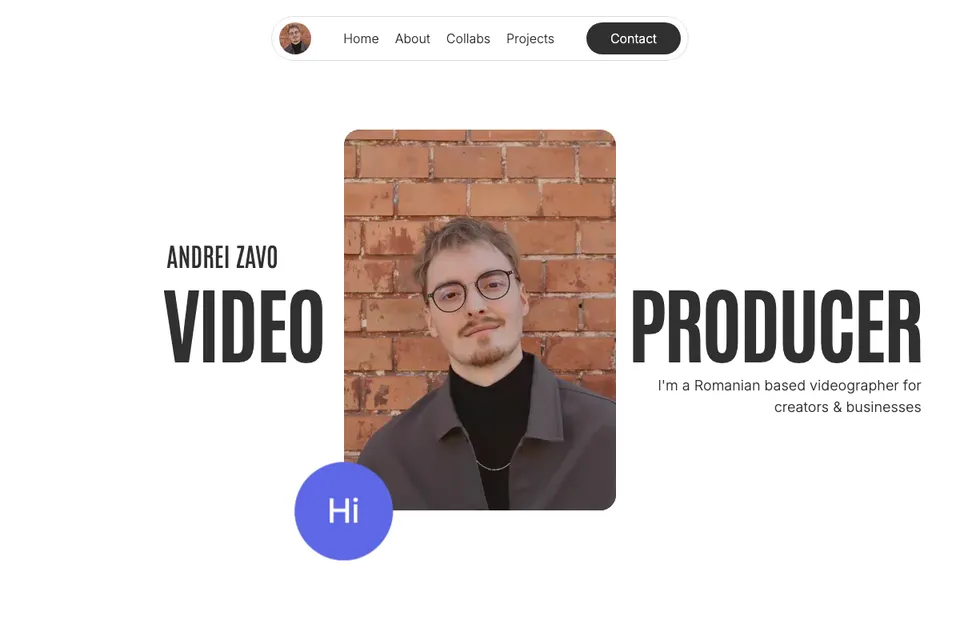
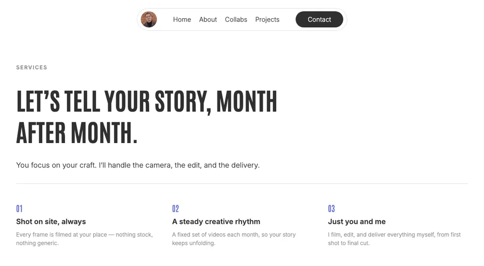

# zavocreates.com

Andrei Zavo's videographer portfolio, rebuilt from a Framer site into code: an Astro static site served by one Cloudflare Worker, with a contact form that checks for spam with Turnstile and labels each enquiry with a Workers AI model before emailing it.

The work was done by AI agents (Claude Code) from a written spec and plan, and checked by tests that compare against the original Framer site. This README explains what was built, how the AI output was verified, and what is still open.

## Problem and result

**Problem.** The site is three pages (`/`, `/pricing`, `/pricing-ro`) on a paid Framer plan. Andrei wanted the same look and motion, free hosting, and a contact form that does not depend on Framer.

**Result.** The rebuild is complete and tested locally and in CI. It is not live yet: the domain still points at Framer until the [go-live checklist](docs/go-live.md) is done.

- Same pages, text and animations as the Framer site, compared screenshot by screenshot against captures of the live site.
- Lighthouse category scores equal to or higher than Framer's on every page and preset, and 28% to 46% less data transferred per page load ([docs/results](docs/results/README.md)).
- Contact form with Turnstile, AI triage and email delivery, working with or without JavaScript.

### Cost

| | Before | After |
| --- | --- | --- |
| Site | Framer plan: <owner to fill> | 0: free plans only (below) |
| Domain | renewal at GoDaddy | unchanged |

Free plans used after the move:

- Cloudflare Workers Free (site and `/api/contact`)
- Workers AI free daily allowance (triage)
- Cloudflare Turnstile (spam check)
- Cloudflare DNS Free plan
- Cloudflare Web Analytics (cookieless)
- Resend free tier, 3,000 emails a month and 100 a day (email delivery)
- GitHub Actions, free for public repositories, including the macOS job

### Lighthouse: Framer vs rebuild

Lighthouse 13.6.0, median of 3 runs per page and preset, default simulated throttling. Framer measured on the live site on 2026-11-10, the rebuild on the local Worker preview on 2026-11-11. Full data and method: [docs/results/README.md](docs/results/README.md).

| Page | Preset | Site | Perf. | Access. | Best pr. | SEO | FCP | LCP | TBT | CLS |
| --- | --- | --- | --- | --- | --- | --- | --- | --- | --- | --- |
| `/` | mobile | Framer | 82 | 92 | 100 | 100 | 1.19 s | 1.19 s | 614 ms | 0.003 |
| `/` | mobile | rebuild | 94 | 100 | 100 | 100 | 0.92 s | 3.11 s | 0 ms | 0.001 |
| `/pricing` | mobile | Framer | 93 | 89 | 100 | 100 | 1.18 s | 1.18 s | 295 ms | 0 |
| `/pricing` | mobile | rebuild | 100 | 100 | 100 | 100 | 0.92 s | 0.92 s | 0 ms | 0 |
| `/` | desktop | Framer | 100 | 92 | 100 | 100 | 0.50 s | 0.50 s | 12 ms | 0.002 |
| `/` | desktop | rebuild | 100 | 100 | 100 | 100 | 0.26 s | 0.56 s | 0 ms | 0 |
| `/pricing` | desktop | Framer | 100 | 89 | 100 | 100 | 0.48 s | 0.48 s | 12 ms | 0 |
| `/pricing` | desktop | rebuild | 100 | 100 | 100 | 100 | 0.25 s | 0.25 s | 0 ms | 0 |

One number is worse: LCP on `/` mobile, 3.11 s against Framer's 1.19 s. The 756 KB animated noise GIF (the same file Framer serves) shares bandwidth with the hero portrait in Lighthouse's simulation. The performance score is still higher because blocking time dropped from 614 ms to 0 ms.

Transfer size per page load (mobile): `/` 1.90 MiB on Framer, 1.36 MiB rebuilt; `/pricing` 1.66 MiB on Framer, 0.90 MiB rebuilt.

### Screenshots

Captured from the built site (`npm run preview`).

<p>
  
  
  
</p>

## Architecture


- **Build.** `content/*.json` holds every visible string, design token and animation value from the Framer project. Zod schemas validate it during `astro build`, which writes static HTML to `./dist`.
- **Runtime.** One Worker (`worker/index.ts`) serves `./dist` as static assets and handles `POST /api/contact`: validate the fields, verify the Turnstile token, ask Workers AI for a structured label, send the email through Resend. If the AI call fails, the email still goes out, marked "Triage unavailable". Messages are never stored.
- **Motion.** Motion (motion.dev) and Lenis, driven only by `content/motion.json`. Nothing moves under `prefers-reduced-motion: reduce`, and every element is visible without JavaScript.

Why each piece was chosen: [docs/decisions.md](docs/decisions.md).

## How AI was used and verified

Claude Code agents implemented the plan in [`docs/superpowers/plans/`](docs/superpowers/plans/2026-11-10-zavocreates-framer-to-cloudflare.md) task by task, from the spec in [`docs/superpowers/specs/`](docs/superpowers/specs/2026-11-10-zavocreates-framer-to-cloudflare-design.md). Each task was reviewed before the next started. Project rules for agents are in [`CLAUDE.md`](CLAUDE.md). The checks below are what makes the output trustworthy, not the agent's own report.

### 1. Content extraction through the Framer MCP connector

An agent read the Framer project with six read-only programs (`docs/extraction/programs/`). Every run reported `changedNodeCount: 0`, so the project was not modified. The raw results are kept in `docs/extraction/raw/`, and `transform.py` turns them into `content/*.json`.

The pitfall: Framer's published HTML contains text visitors never see. On `/pricing-ro`, FAQ 3 reads "Nu prea — voi veniți cu povestea voastră" in the HTML, but a visitor who opens it reads "Nu chiar. Voi veniți cu povestea voastră". Scraping would have shipped the wrong line. `transform.py` reads each string by Framer node id or component control and exits if a node it reads is hidden. Unit tests check that known hidden strings (for example "Interaction design and micro-animations") appear nowhere in `content/`. Details: [docs/extraction/README.md](docs/extraction/README.md).

### 2. Visual regression against the Framer site

Before anything changed, screenshots of the live Framer site were captured for 3 pages at 3 breakpoints (1200, 810 and 390 px wide) and committed to `tests/visual/baseline/`. Each one is scroll-stitched: the page is visited in 900 px steps and each step waits for counters, reveals and sticky images to settle. The rebuild is captured the same way and compared with a maximum of 2% differing pixels. Measured differences when the pages were built: 0.35%, 0.37% and 0.52% for the three home captures, under 0.09% for the six pricing captures. The tolerance was never raised, and the baselines are never regenerated.

### 3. Worker tests

23 tests run in the Workers runtime (`tests/worker/contact.test.ts`) with Workers AI, Turnstile and Resend stubbed. They check these properties:

- A failed Turnstile check returns 403 and makes no AI call and no email call.
- Invalid fields return 400; a body over 20 KB returns 413, including a streamed body without `Content-Length`; other content types return 415; `GET` returns 405.
- The visitor's message is sent to the model as JSON data inside a delimited block, in JSON mode. Output that fails the schema is retried once.
- If the AI throws or returns invalid output twice, the email is still sent with the original message and a "Triage unavailable" note.
- HTML in the message and in the AI's text is escaped in the email; CR and LF are stripped from the subject; `reply_to` is the visitor's address.
- A 5,000-character Romanian message with emoji arrives intact.
- The no-JS form path answers with a 303 redirect to `/#contact-sent` or `/#contact-error`.

### 4. Triage eval (pending)

`evals/triage/` holds 20 hand-written enquiries (8 English, 8 Romanian, 4 spam or off-topic, one of them a prompt-injection attempt) with the expected category, language and urgency. `run.ts` sends them through the Worker's own `triage()` function and reports per-field accuracy, schema-valid rate, latency and retries. The rule: at least 90% category accuracy and 100% schema-valid output.

It has not been run yet, because it needs a Cloudflare account; it runs at go-live. Until then the model is a provisional choice, `@cf/ibm-granite/granite-4.0-h-micro`. Candidates and results: [evals/triage/results.md](evals/triage/results.md).

### 5. Lighthouse budgets in CI

`lighthouserc.json` fails the build if any mobile score drops below the higher of a fixed floor and Framer's own median, so the rebuild can never score below the site it replaces. `/` must reach performance 0.90, accessibility 0.95, best practices 1.00 and SEO 1.00; `/pricing` must reach 0.93, 0.95, 1.00 and 1.00. The margin on `/` performance is small: the last three runs scored 94.

### Other checks

End-to-end tests (Playwright) cover routes and the 404 page, SEO tags and `hreflang`, the contact form, the page with JavaScript off, and `prefers-reduced-motion: reduce`. A link check runs over every built page, external links included.

## Run locally

Needs Node 22 or newer (`.nvmrc`).

```sh
npm install
npx playwright install chromium
cp .dev.vars.example .dev.vars   # dummy local secrets, git-ignored
```

| Command | What it does |
| --- | --- |
| `npm run dev` | Astro dev server |
| `npm run build` | build the static site into `./dist` |
| `npm run preview` | `wrangler dev` on http://localhost:8787, serving `./dist` and the Worker (build first) |
| `npm run test:unit` | Vitest, `tests/unit/` |
| `npm run test:worker` | Vitest in the Workers runtime, `tests/worker/` |
| `npm run test:e2e` | Playwright, `tests/e2e/` (builds and starts the preview itself); filter with `npm run test:e2e -- smoke` |
| `npm run test:visual` | Playwright visual tests against the Framer baselines, `tests/visual/` |
| `npm run check:links` | link check over `./dist` |
| `npm run lhci` | Lighthouse CI |

Build-time variables (see `.env.example`): `PUBLIC_TURNSTILE_SITE_KEY` (unset: Cloudflare's always-pass test key) and `PUBLIC_CF_ANALYTICS_TOKEN` (unset: no analytics beacon).

## Status / go-live

Built and tested; not live. The remaining steps, including the triage eval run and the open questions for Andrei, are in [docs/go-live.md](docs/go-live.md).

## UX / frontend

To be written with Andrei.
