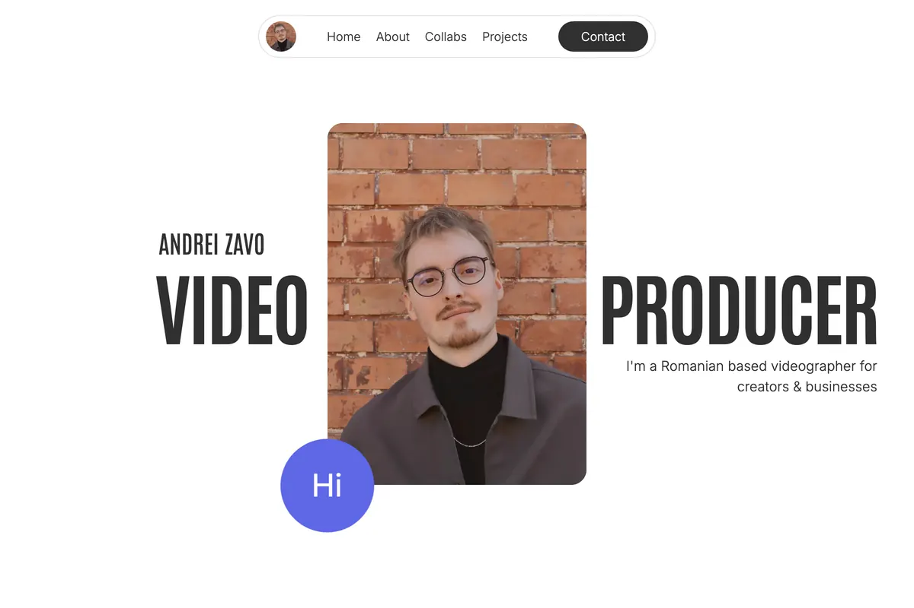
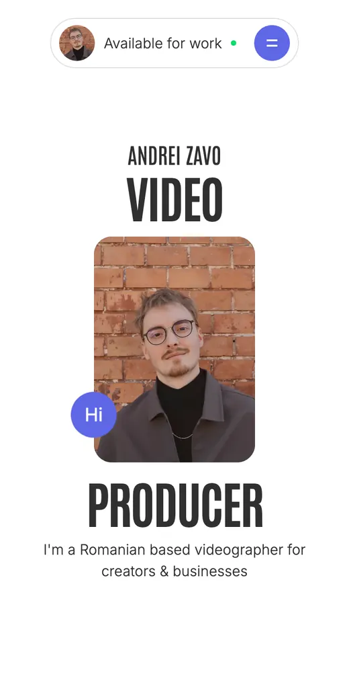
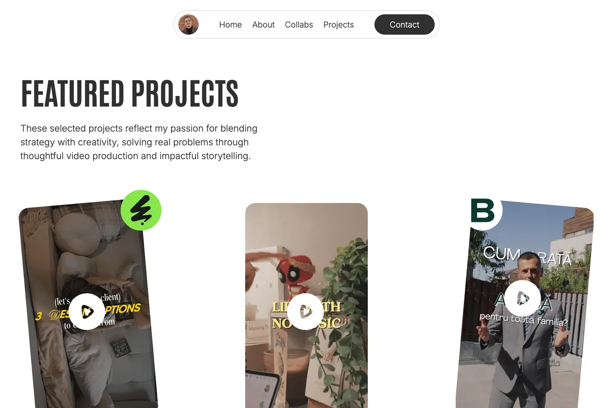
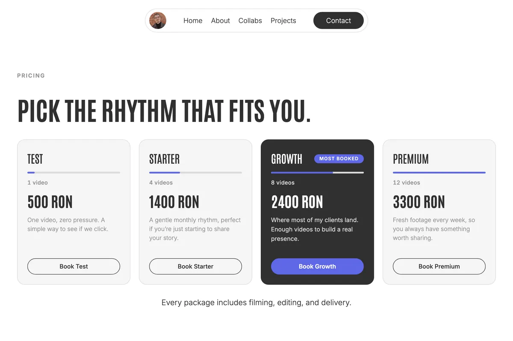
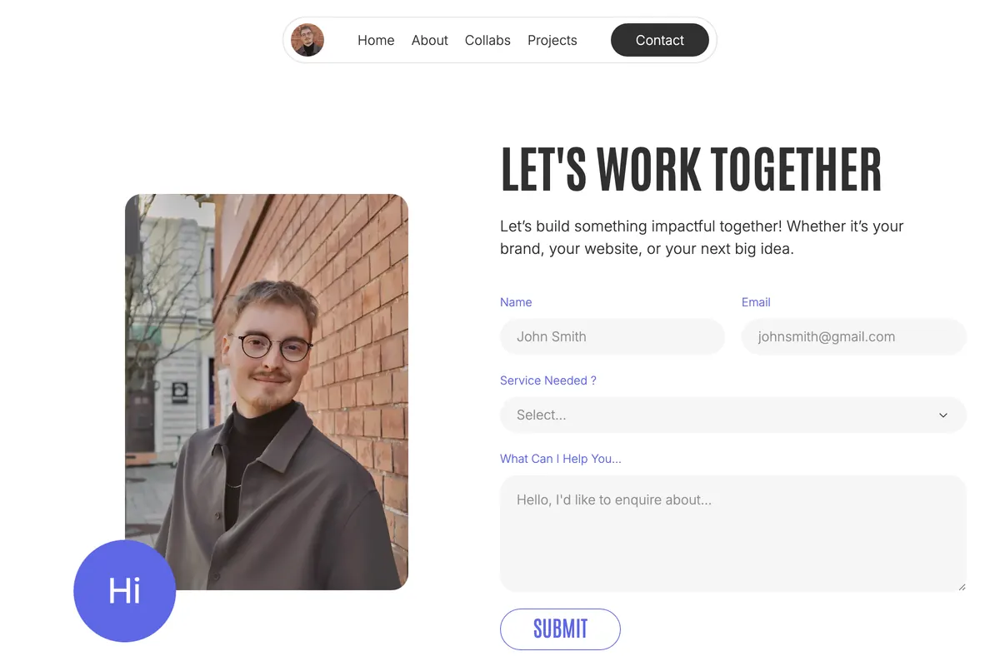
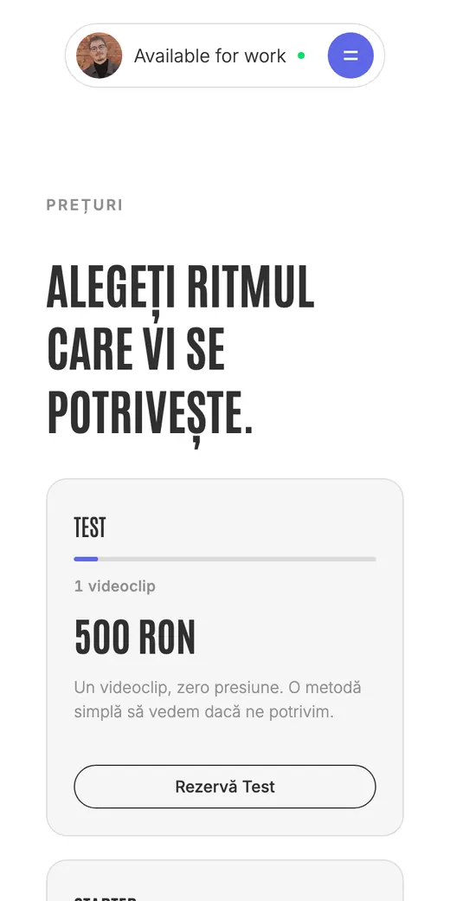
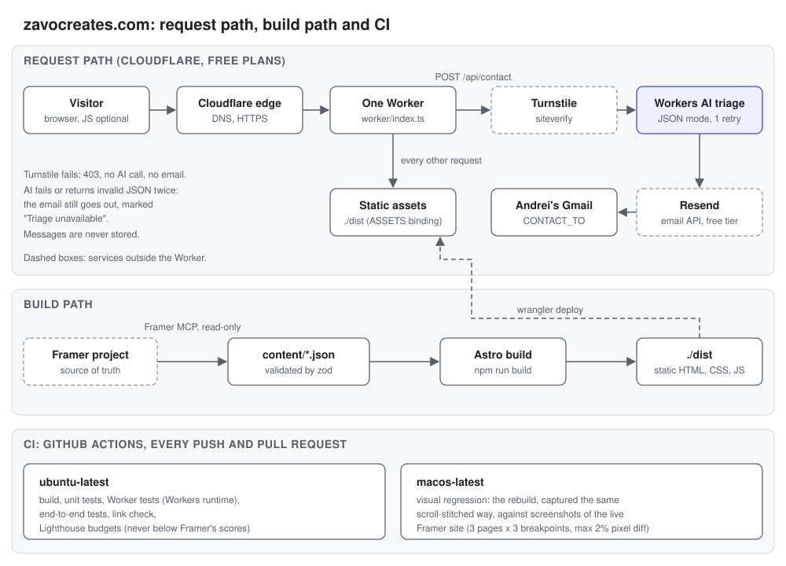

# zavocreates.com

Andrei Zavo's videographer portfolio, moved from Framer to code by AI agents (Claude Code) and checked against the original site with tests.

**Live:** [zavocreates.com](https://zavocreates.com) · **Stack:** Astro, one Cloudflare Worker, Turnstile, Workers AI, Resend

<table>
  <tr>
    <td width="70%"></td>
    <td width="30%"></td>
  </tr>
</table>

## Results

| | Framer | Now |
| --- | --- | --- |
| Hosting cost | $15 a month | **$0** (free plans only) |
| Lighthouse performance, mobile `/` | 82 | **94** |
| Lighthouse accessibility, `/` and `/pricing` | 92 and 89 | **100** |
| Data per page load, mobile `/` | 1.90 MiB | **1.36 MiB** |

Same pages, text and animations as the Framer site. Full Lighthouse data: [docs/results](docs/results/README.md).

<table>
  <tr>
    <td></td>
    <td></td>
  </tr>
  <tr>
    <td></td>
    <td align="center"></td>
  </tr>
</table>

## How it works



- **Content.** Every string, design token and animation value was read from the Framer project, not scraped from its HTML, which contains text visitors never see. It lives in `content/*.json`.
- **Site.** Astro builds static HTML. Motion and Lenis reproduce Framer's animations. Everything works without JavaScript, and nothing moves under reduced motion.
- **Contact form.** Turnstile stops bots. A Workers AI model summarises and labels each message. Resend delivers two emails in one Gmail thread: private notes first, then the visitor's message, so a reply quotes only the visitor. Nothing is stored.

## How the AI's work was checked

- **Visual tests:** 9 screenshots of the live Framer site (3 pages × 3 widths) are compared with the rebuild, with at most 2% of pixels allowed to differ.
- **Worker tests:** 29 tests of the contact API in the Workers runtime: spam check, missing secrets, bad input, AI failures, email escaping.
- **Lighthouse budgets in CI:** the build fails if a score drops below Framer's.
- **Plus:** end-to-end tests (routes, SEO, form, no-JS, reduced motion) and a link check on every pull request.

The agents worked from a written [spec](docs/superpowers/specs/2026-11-10-zavocreates-framer-to-cloudflare-design.md) and [plan](docs/superpowers/plans/2026-11-10-zavocreates-framer-to-cloudflare.md), one reviewed task at a time. Why each choice was made: [docs/decisions.md](docs/decisions.md).

## Run locally

Node 22.23.4+.

```sh
npm install
npm run build && npm run preview   # http://localhost:8787
npm run test:e2e
```

All commands and setup: [CLAUDE.md](CLAUDE.md). Go-live steps: [docs/go-live.md](docs/go-live.md).
